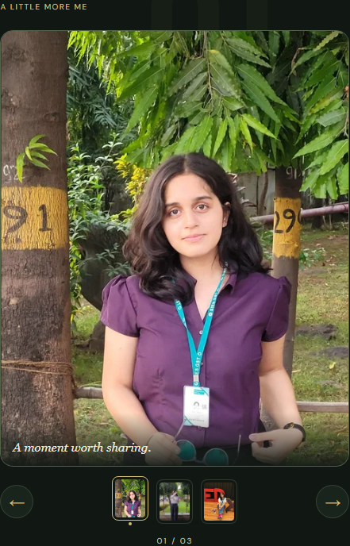
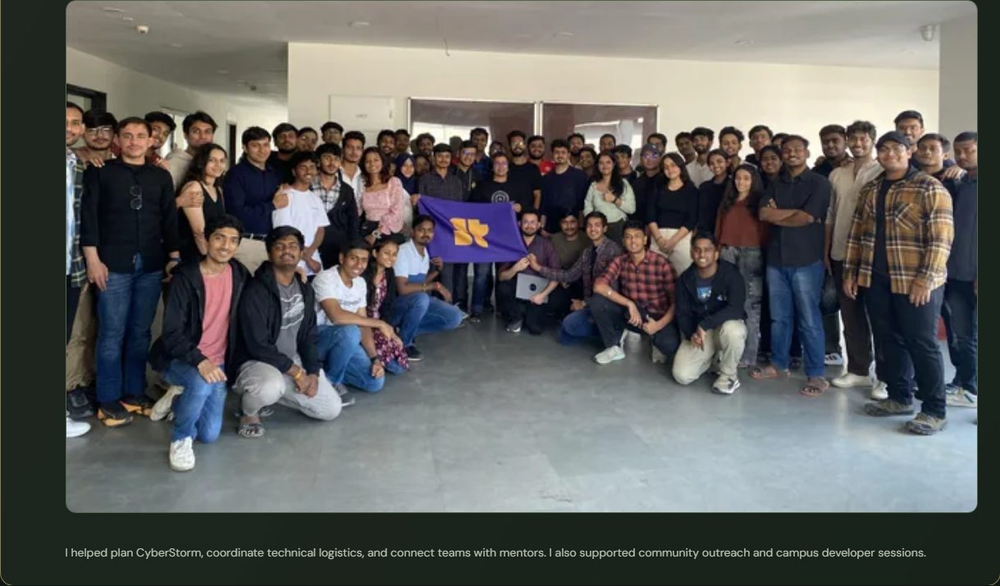
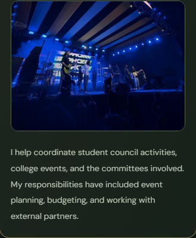

# Migration verification

Verified on 3 November 2026 against the Vite production build. Source of truth: original portfolio commit `a3d519c`; all six original commits were inspected before implementation.

The latest revision replaces the hero with the user-supplied professional portrait, removes its background, adds persistent and pointer-driven hero interactions, moves labels below the face, and aligns the About text and photograph. The remaining sections retain their existing implementation.

The earlier photo update assigned the supplied group photograph to the existing GDG card and the stage photograph to General Secretary. The current revision changes only the About gallery: purple-shirt campus portrait, seated TEDx photograph, and the newly uploaded podium photograph, in that order. The left heading and biography, hero, projects, experience, leadership and contact implementation are unchanged in this revision.

The three user-provided headings and descriptions appear verbatim beneath the photographs. Portrait frames contain per-photo crops; the complete landscape TEDx composition uses contain sizing over a dimmed, blurred duplicate of the same photograph. The podium original is archived unchanged; responsive WebP derivatives use Sharp without retouching faces. Photo decoding completes before navigation replaces the current image. An intersection observer warms the image cache near About and disconnects on completion or unmount.

Motion combines directional sliding, rotation around the lower card edge, scale depth, masks, fanning photographic back cards, and coordinated masked caption transitions. A transition lock coalesces rapid requests into the latest destination. Captions occupy reserved space to prevent layout shifts. Controls support thumbnails, previous/next, arrow keys, Home/End, and touch swipes. Vertical gestures retain native scrolling; there is no pinning or scroll capture.

## Results

| Check | Result |
| --- | --- |
| Production build | Pass |
| ESLint, including React Hooks rules | Pass, no warnings |
| Original content / original asset SHA-256 checks | Pass |
| Chromium 1440 × 900 | 6 tests passed; touch-only test skipped |
| Chromium 768 × 1024 | 6 tests passed; touch-only test skipped |
| Chromium 390 × 844 | 7 tests passed |
| Chromium 320 × 740 | 7 tests passed |
| axe WCAG 2 A/AA and 2.1 AA scans, page and project dialog, all sizes | No violations detected |
| Production dependency audit | No vulnerabilities reported |

The 26 applicable browser tests (plus two intentional desktop/tablet touch skips) cover the new photo assignments, gallery controls, animated and reduced-motion gallery navigation, original image loading, continuous hero motion after entrance, pointer response, keyboard/click interest selection, protected-face clearance, photo-picker clearance, About column alignment, original visible text fragments, role copy, original links, asset loading, horizontal overflow and image containment, project details and demo-video wiring, repository link, Escape handling, modal focus and restoration, whole-card leadership interaction by photo/text/keyboard, mobile navigation, native form validation, reduced motion, scroll animation, and resizing. The FormSubmit form was not submitted; tests do not send email. Browser tests run against the production server, not the Vite development server.

Visual review included desktop/mobile hero composition, numbered section flow, About photo alignment, mobile experience cards, and the expanded TEDx card. The original event JPEG is sideways; display derivatives rotate it correctly without altering the original file. Original files remain available at their original public URLs.

## Motion and performance

- Masked hero letters, coordinated portrait entrance, persistent orbital motion and portrait float, pointer-driven depth, linked lower-portrait cards, and clickable interest controls; no pinned empty scroll interval.
- Word-mask typography, changing chapter atmosphere, photo crop/rotation choreography, project image wipes and spring-driven pointer tilt.
- Project dialog grows from the clicked card rectangle; detail text and media enter in sequence. Native dialog semantics plus keyboard controls are retained.
- Experience cards reveal across the timeline with a growing accent rail.
- Glass leadership cards animate measured content height and photograph scale. The entire visible surface toggles expansion.
- Motion preference changes revert GSAP contexts. OS reduced motion and the visible pause control suppress scripted and CSS motion. Touch devices do not receive pointer tilt.
- Responsive WebP images, reserved image geometry, lazy-loaded below-fold photos, and on-demand video. The replacement professional hero's alpha-preserving 640px WebP is approximately 66 KB. The original portfolio assets remain archived unchanged.

## References and limits

The Ashutosh Mujumdar Framer portfolio linked from Wall of Portfolios was inspected directly. Earlier Pinterest references were limited by sign-up overlays. For the latest About reference, Pinterest pin 1027031890040601748 links to the public Behance project [Professional 3D Music Interface Showcase for Artists](https://www.behance.net/gallery/244188651/Professional-3D-Music-Interface-Showcase-for-Artists). Its embedded seven-second animation was inspected through the public player: cards emerge, fan with depth and tilt, and settle above a folder base. The About implementation adapts that layered motion to personal photography rather than copying the music artwork. The implementation uses comparable layering, masked typography, spatial card motion and paced section transitions while retaining this portfolio's content and palette.

Automated browser coverage is Chromium. Safari and Firefox have not been run. Automated accessibility scans supplement, and do not replace, human assistive-technology testing. The npm audit reports six moderate findings in development-only ESLint/minimatch dependencies; production dependencies have none. No incompatible major dependency overrides were applied to hide those findings.

The transparent replacement portrait and the exact built-in image-edit prompt are documented in [portrait-edit.md](portrait-edit.md).

## Review screenshots

## Publication

No merge or deployment was performed. The feature branch has a PR validation workflow and a main-only Pages deployment job. Before an approved merge, set the repository's Pages source to **GitHub Actions** as described in the README. The existing production settings have not been changed.

### Added photo review

## About photographic story verification

Forward and backward selection of all three photos, wraparound, Home/End, rapid six-click input, stable gallery height and captions below photographs passed at all four screen sizes. Real Chromium touch events tested three forward swipes, backward wraparound, and vertical scrolling without changing photos at both mobile sizes. Page and dialog axe checks include the new gallery; exiting cards and captions are hidden from assistive technology. Reduced motion removes travel, rotation and timing while retaining navigation.

Current visual evidence:

- [Desktop About layout](qa/desktop-about-story-layout.png)
- [Layered transition in progress](qa/desktop-about-story-transition.png)
- Desktop: [portrait](qa/desktop-about-story-1.png), [TEDx](qa/desktop-about-story-2.png), [podium](qa/desktop-about-story-3.png)
- Mobile: [portrait](qa/mobile-about-story-1.png), [TEDx](qa/mobile-about-story-2.png), [podium](qa/mobile-about-story-3.png)
- Tablet and 320px screenshots are also saved in `docs/qa/*-about-story-*.png`.

Only the requested original About placeholder caption is exempted from the historical visible-text baseline; the replacement captions are tested separately. The original white-shirt photograph remains in public assets. No other section source was modified for this revision.
