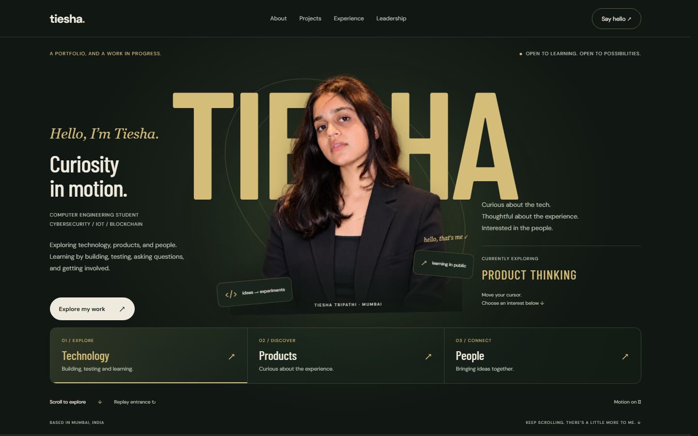
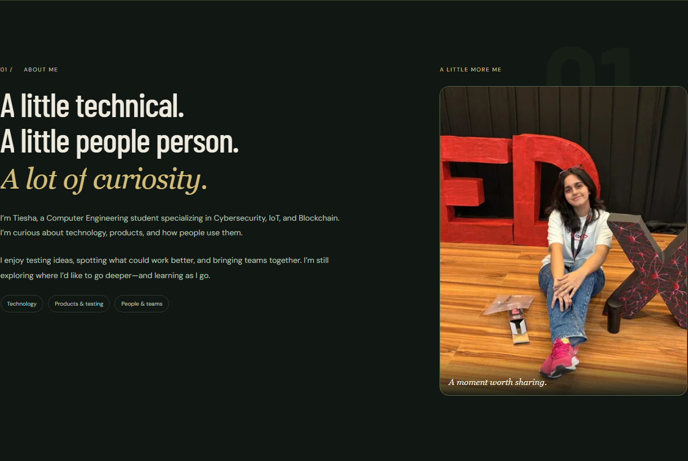
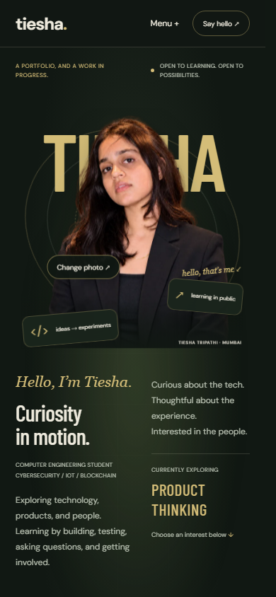
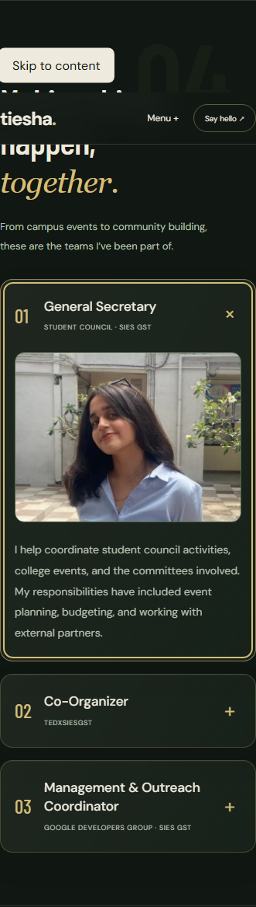

# Migration verification

Verified on 2 November 2026 against the Vite production build. Source of truth: original portfolio commit `a3d519c`; all six original commits were inspected before implementation.

The latest revision replaces the hero with the user-supplied professional portrait, removes its background, adds persistent and pointer-driven hero interactions, moves labels below the face, and aligns the About text and photograph. The remaining sections retain their existing implementation.

## Results

| Check | Result |
| --- | --- |
| Production build | Pass |
| ESLint, including React Hooks rules | Pass, no warnings |
| Original content / original asset SHA-256 checks | Pass |
| Chromium 1440 × 900 | 4 tests passed |
| Chromium 768 × 1024 | 4 tests passed |
| Chromium 390 × 844 | 4 tests passed |
| Chromium 320 × 740 | 4 tests passed |
| axe WCAG 2 A/AA and 2.1 AA scans, page and project dialog, all sizes | No violations detected |
| Production dependency audit | No vulnerabilities reported |

The 16 browser tests cover continuous hero motion after entrance, pointer response, keyboard/click interest selection, protected-face clearance, photo-picker clearance, About column alignment, original visible text fragments, role copy, original links, asset loading, horizontal overflow and image containment, project details and demo-video wiring, repository link, Escape handling, modal focus and restoration, whole-card leadership interaction by photo/text/keyboard, mobile navigation, native form validation, reduced motion, scroll animation, and resizing. The FormSubmit form was not submitted; tests do not send email. Browser tests run against the production server, not the Vite development server.

Visual review included desktop/mobile hero composition, numbered section flow, About photo alignment, mobile experience cards, and the expanded TEDx card. The original event JPEG is sideways; display derivatives rotate it correctly without altering the original file. Original files remain available at their original public URLs.

## Motion and performance

- Masked hero letters, coordinated portrait entrance, persistent orbital motion and portrait float, pointer-driven depth, linked lower-portrait cards, and clickable interest controls; no pinned empty scroll interval.
- Word-mask typography, changing chapter atmosphere, photo crop/rotation choreography, project image wipes and spring-driven pointer tilt.
- Project dialog grows from the clicked card rectangle; detail text and media enter in sequence. Native dialog semantics plus keyboard controls are retained.
- Experience cards reveal across the timeline with a growing accent rail.
- Glass leadership cards animate measured content height and photograph scale. The entire visible surface toggles expansion.
- Motion preference changes revert GSAP contexts. OS reduced motion and the visible pause control suppress scripted and CSS motion. Touch devices do not receive pointer tilt.
- Responsive WebP images, reserved image geometry, lazy-loaded below-fold photos, and on-demand video. The replacement professional hero's alpha-preserving 640px WebP is approximately 66 KB. The original portfolio assets remain archived unchanged.

## References and limits

The Ashutosh Mujumdar Framer portfolio linked from Wall of Portfolios was inspected directly. The supplied Pinterest links, including the follow-up interaction reference, resolved to their clip pages; Pinterest's sign-up overlay prevented detailed frame-by-frame inspection. The implementation uses comparable layering, masked typography, spatial card motion and paced section transitions while retaining this portfolio's content and palette.

Automated browser coverage is Chromium. Safari and Firefox have not been run. Automated accessibility scans supplement, and do not replace, human assistive-technology testing. The npm audit reports six moderate findings in development-only ESLint/minimatch dependencies; production dependencies have none. No incompatible major dependency overrides were applied to hide those findings.

The transparent replacement portrait and the exact built-in image-edit prompt are documented in [portrait-edit.md](portrait-edit.md).

## Review screenshots

## Publication

No merge or deployment was performed. The feature branch has a PR validation workflow and a main-only Pages deployment job. Before an approved merge, set the repository's Pages source to **GitHub Actions** as described in the README. The existing production settings have not been changed.
